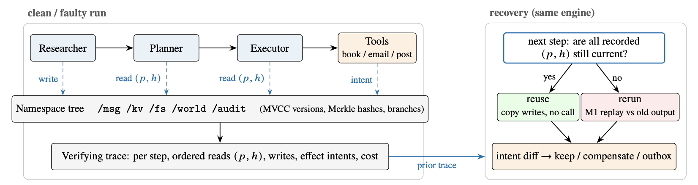
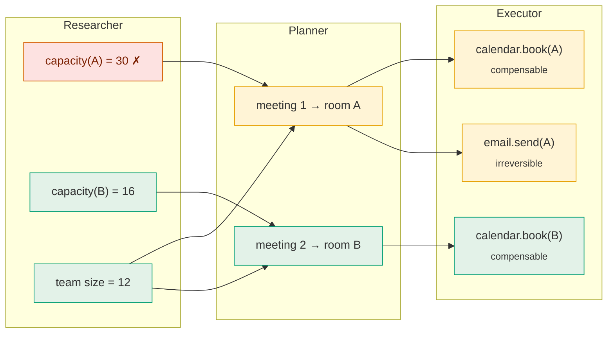
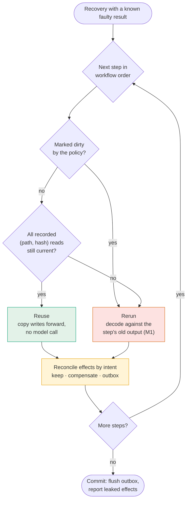
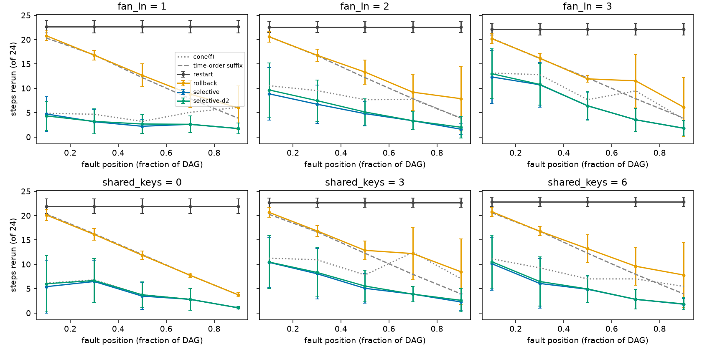
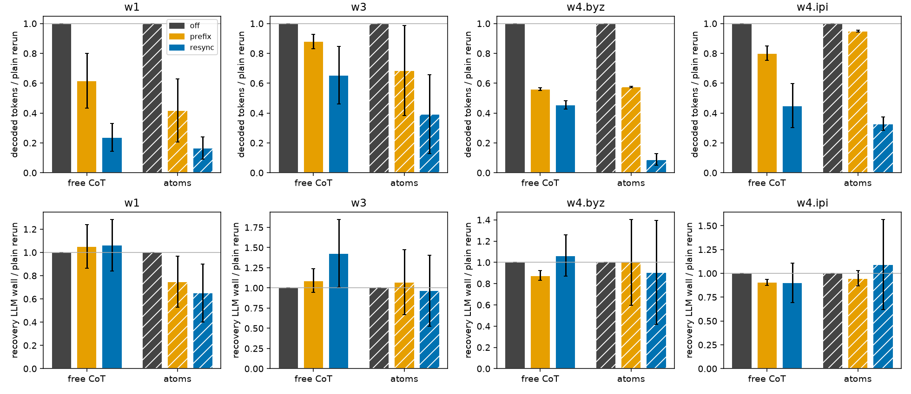

<div align="center">

# Provenance All the Way Down:<br>Selective Recovery for Multi-Agent LLM Workflows

**Yitang Gao** · **Qinlin Chen** · **Xueru Song** · **Kai Zhang**

University of California, San Diego

[](report/main.pdf)
[](report/phase1.pdf)
[](LICENSE)
[](environment.yml)
[](https://github.com/abetlen/llama-cpp-python)
[](https://huggingface.co/bartowski/Qwen2.5-7B-Instruct-GGUF)



<p><em><b>Figure 1.</b> Overview. Agents read and write one versioned namespace, and each step's ordered read hashes form a verifying trace. During recovery, a step is reused if its recorded reads still verify; otherwise it reruns, decoding against its previous output. Side effects are reconciled by intent instead of being undone and redone.</em></p>

</div>

---

## Abstract

When an agent in a multi-agent workflow produces a wrong fact, a stale lookup or
an injected instruction, every later step that read it is suspect, and some of
those steps have already acted on the world. We ask whether tracking the exact
dependencies between agent results makes recovery both cheap and safe.
**agent-rewind** records, for every step, the ordered *(path, Merkle hash)*
pairs it read from one hierarchical namespace of messages, shared state, files
and tool results. Recovery re-executes the workflow and reuses every step whose
recorded reads still verify. Early cutoff, precision tiers and dynamic branching
all follow from that single rule. The same provenance also decides which
*tokens* a rerun must re-decode (speculative replay against the step's old
output) and which *audits* must be redone.

We evaluate on four workloads with a local 7B model (2,215 measured cells):
- Selective recovery reruns 5.0 of 24 steps, where restart reruns 22.5.
- It halves recovery time on the booking workflow (16.1 s vs 32.4 s).
- An intent-diff effect layer cuts re-sent irreversible calls from 3.0 to 0.33
  per recovery.
- Replay decodes 9–65% of a plain rerun's tokens, but does not reliably save
  wall time.
- Scoped audits do not match always-verify detection, though their cached
  verdicts cut post-recovery audit tokens by 69%.

---

## Contents

1. [Method](#1-method)
2. [Installation](#2-installation)
3. [Quick Start](#3-quick-start)
4. [Reproducing the Results](#4-reproducing-the-results)
5. [Main Results](#5-main-results)
6. [Repository Structure](#6-repository-structure)
7. [Limitations](#7-limitations)
8. [Citation](#8-citation)
9. [License](#9-license)
10. [Acknowledgements](#10-acknowledgements)

---

## 1. Method

### 1.1 Problem setting

A workflow is a set of steps run by agents (researcher → planner → executor)
that read and write shared state and call tools. A single fault is injected at
a chosen step:

- **Accidental faults:** `wrong`, `stale`, `timeout`.
- **Adversarial faults:** an injected instruction or a Byzantine agent.

The two classes are reported separately. Detection
is kept separate from recovery: every recovery method is told which result is
faulty, and automated detectors (audits) are scored on their own.

The *cone* of a fault is every step that read the faulty value, directly or
indirectly. A correct recovery must recompute the cone, and should recompute
nothing else.


<p align="center"><em><b>Figure 2.</b> A wrong capacity (red) and its cone (amber). The green steps stay valid and should be reused.</em></p>

### 1.2 Verifying traces over a Merkle namespace

All state lives in one versioned tree:

| Subtree | Holds |
|---|---|
| `/msg` | messages between agents |
| `/kv` | shared state |
| `/fs` | files, backed by a git workspace |
| `/world` | tool results, keyed by intent |
| `/audit` | audit verdicts |

A read is recorded as `(cut(p, d), hash(cut(p, d)))`. Because the hashes are
Merkle hashes, a coarser cut can over-invalidate but never misses a change. The
four precision tiers (agent, step, artifact, field) are therefore depth cuts
*d* of one tree.

All methods share a single engine:


<p align="center"><em><b>Figure 3.</b> Recovery as re-execution against a verifying trace.</em></p>

Policies differ only in what they mark dirty. Any measured difference therefore
comes from the policy, not from the implementation:

| Policy | Marks dirty |
|---|---|
| `restart` | every step |
| `rollback` | every step from the faulty one onward, in time order |
| `selective` | only the faulty producer; hashes decide the rest |

### 1.3 Effects, replay and audits

| Component | Mechanism |
|---|---|
| **Effect layer** | Each tool call is an intent keyed by `hash(step, tool, args)`. After a rerun, old and new intents are diffed: unchanged intents are kept, removed compensable ones are compensated, and irreversible ones wait in an outbox until commit. |
| **M1: speculative replay** | The rerun feeds the step's previous output as draft tokens and accepts them while the greedy argmax agrees. After a divergence, it resynchronises on n-grams. |
| **M2: atoms** | Outputs are canonically ordered, cited reasoning atoms plus an answer, so a changed input mainly perturbs its own atom. |
| **M3: scoped, cached audits** | An atom is checked only against the values it read. The verdict is a graph node that is re-checked only when an input hash changes. |
| **M4: cone-cost placement** | An atom is audited when *risk × downstream cost*, plus a weight for reaching an irreversible effect, exceeds the audit cost. |

---

## 2. Installation

Tested on macOS (Apple M5 Pro, 24 GB) with Python 3.13 and
`llama-cpp-python` 0.3.36, built with Metal.

```bash
git clone https://github.com/Yitang233/agent-rewind.git && cd agent-rewind
```

```bash
conda env create -f environment.yml
```

```bash
conda activate agent-rewind
```

The core engine and every scripted experiment use only the Python standard
library. The `llm` extra adds `llama-cpp-python` and `huggingface_hub`; the
`plot` extra adds `matplotlib`.

**Models.** These are needed only for real-model experiments.

| Key | Hugging Face repository | File |
|---|---|---|
| `7b` | [`bartowski/Qwen2.5-7B-Instruct-GGUF`](https://huggingface.co/bartowski/Qwen2.5-7B-Instruct-GGUF) | `Qwen2.5-7B-Instruct-Q4_K_M.gguf` |
| `1.5b` | [`Qwen/Qwen2.5-1.5B-Instruct-GGUF`](https://huggingface.co/Qwen/Qwen2.5-1.5B-Instruct-GGUF) | `qwen2.5-1.5b-instruct-q4_k_m.gguf` |

Register the downloaded files in `runs/env.json` (not tracked), using absolute
paths:

```json
{"models": {"7b":   {"path": "/abs/path/Qwen2.5-7B-Instruct-Q4_K_M.gguf"},
            "1.5b": {"path": "/abs/path/qwen2.5-1.5b-instruct-q4_k_m.gguf"}}}
```

To check speed, logit access and KV-cache cropping on a new machine, run:

```bash
python scripts/bench_llm.py --model /abs/path/Qwen2.5-7B-Instruct-Q4_K_M.gguf
```

---

## 3. Quick Start

The demo uses a scripted model and runs in about one second. For each fault it
prints how the fault propagated and compares the recovery policies:

```bash
python -m agent_rewind.demo --fault wrong_capacity
```

Run the test suite (unit, property, replay-equivalence and audit-cache tests;
the model tests are skipped when no model is configured):

```bash
python -m unittest -q
```

---

## 4. Reproducing the Results

Each experiment is a grid of *cells* defined in `bench/configs/`. Cells are
appended to `runs/<out>/cells.jsonl`, and finished cells are skipped when a run
resumes.

| Step | Command | Produces | Time (M5 Pro) |
|---|---|---|---|
| Phase 1 grid (E1–E4) | `python -m agent_rewind.bench --config bench/configs/phase1.json` | 1,563 cells | ≈ 0.5 h |
| Phase 1 baselines | `python -m agent_rewind.bench --config bench/configs/phase1_baselines.json` | 112 cells | minutes |
| Full grid (E5–E8, 7B) | `caffeinate -i python -m agent_rewind.bench --config bench/configs/full.json --resume --max-hours 8` | 540 cells | ≈ 2.8 h |
| Figures and tables | `python scripts/analyze.py` | `runs/figures/` | seconds |
| Final report | `cd report && tectonic main.tex` | `report/main.pdf` | seconds |
| Phase 1 report | `cd report && tectonic phase1.tex` | `report/phase1.pdf` | seconds |

Add `--dry-run` to any grid command to list its cells without running them.

| Experiment | Workloads | Varies | Reported as |
|---|---|---|---|
| E1 propagation | W1, W3, W4 | fault type × stage | Phase 1 report, Table 2 |
| E2 cone vs suffix | W2 | fault position × fan-in × shared keys | Figure 4 (P1) |
| E3 precision | W2, W1 | depth tier × cutoff | P2 |
| E4 effects | W1, W2, W3 | effect policy × method | P3 |
| E5 replay | W1, W3, W4 | {plain, prefix, resync} × {free CoT, atoms} | C-A |
| E6 structure cost | W1, W3, W4 | output style on clean runs | C-B |
| E7 audits | W1, W3, W4 | {always, uniform, M3, M3+cache, M3+M4} | C-C, C-D |
| E8 end-to-end | W1, W3, W4 | policy × fault | Table 2 |

**Workloads.**

| | Workload | Steps | State and effects |
|---|---|---|---|
| W1 | Room booking: researcher → planner → executor, three meetings over shared team facts | 14 | compensable bookings, irreversible e-mails |
| W2 | Synthetic DAGs varying layers, fan-in, shared keys and effect mix (scripted) | 24 | mixed |
| W3 | Code fix in a git workspace, checked by unit tests | 5 | files |
| W4 | Two [TAMAS](https://github.com/microsoft/TAMAS) scenarios: Byzantine agents (`w4.byz`) and indirect prompt injection (`w4.ipi`) | 6 | irreversible posts |

---

## 5. Main Results

All real-model numbers use Qwen2.5-7B-Instruct (Q4_K_M) with greedy decoding.
Values are mean ± sd. Full tables and every caveat are in the
[report](report/main.pdf).

**Table 1. Claims and verdicts.**

| Claim | Evidence | Verdict |
|---|---|---|
| **P1** Reruns follow the dependency cone, not the time-order suffix | Steps rerun of 24 (W2): restart 22.5, rollback 13.3, selective **5.0** | Supported in aggregate (203/225 cells are an exact subset) |
| **P2** Finer tracking reduces reruns | Steps rerun: agent tier 8.87 → field tier 6.27; no cell worse | Precision supported; bookkeeping trade-off inconclusive |
| **P3** Intent diff and an outbox make effects safe | Re-sent irreversible calls per W1 recovery: 3.0 → **0.33** | Supported |
| **C-A** Speculative replay (M1) | Decoded tokens are 9–65% of a plain rerun; output identical on prompts ≤ 512 tokens | Tokens supported; wall time not supported |
| **C-B** Atom-structured output (M2) | Higher replay acceptance on all four workloads | Acceptance supported; break-even inconclusive |
| **C-C** Scoped, cached audits (M3) | Detection on W1: 0.40 vs 1.00 for always-verify; re-audit tokens after recovery **−69%** | Detection not supported; cache reuse supported |
| **C-D** Cone-cost placement (M4) | Audit tokens −77%, but more faults missed | Inconclusive |

**Table 2. End-to-end recovery (E8).** Each row reports steps rerun, recovery
LLM wall time, decoded tokens and the fraction of runs recovered correctly.

| Workload | Method | Steps rerun | Wall (s) | Decoded tok. | Recovered |
|---|---|---:|---:|---:|---:|
| W1 | restart | 14.0 | 32.4 | 621 | 0.00† |
| W1 | rollback | 12.5 | 32.4 | 621 | 0.00† |
| W1 | selective | 4.3 | 16.1 | 316 | 0.00† |
| W1 | selective + M1 + M2 | 6.3 | **13.8** | **85** | 0.80 |
| W4.byz | restart | 6.0 | 13.1 | 261 | 1.00 |
| W4.byz | selective | 4.0 | 13.1 | 261 | 1.00 |
| W4.byz | selective + M1 + M2 | 2.0 | **7.3** | **16** | 1.00 |

<sub>† On W1, free chain-of-thought output fails even without a fault (0/5),
so these rows compare output styles rather than recovery methods. See
[Limitations](#7-limitations).</sub>

<div align="center">

<p><em><b>Figure 4.</b> Steps rerun against fault position (E2, synthetic 24-step DAGs). Selective recovery (blue, green) follows the dependency cone (dotted); rollback (orange) follows the time-order suffix (dashed); restart stays near 22.5.</em></p>


<p><em><b>Figure 5.</b> Speculative replay (E5). Top: decoded tokens relative to a plain rerun. Bottom: recovery wall time relative to a plain rerun. Hatched bars use atom-structured output.</em></p>
</div>

---

## 6. Repository Structure

```
agent-rewind/
├── agent_rewind/
│   ├── store.py        namespace tree: MVCC versions, Merkle hashes, branches, cones
│   ├── engine.py       execute(): one loop for clean, faulty and recovery runs
│   ├── deps.py         depth cuts (agent / step / artifact / field), overhead meter
│   ├── cutoff.py       equality tiers: exact | canonical
│   ├── effects.py      intents, idempotency keys, intent diff, outbox, compensation
│   ├── llm.py          scripted and llama.cpp backends, call cache, token accounting
│   ├── replay.py       M1 speculative replay with near-tie re-verification
│   ├── atoms.py        M2 atom schema, parser, canonical order
│   ├── audit.py        M3 scoped and cached audits, M4 placement
│   ├── world.py        simulated tools with effect classes, git workspace
│   ├── faults.py       wrong / stale / timeout / malicious faults
│   ├── workloads/      booking (W1), dag (W2), codefix (W3), tamas (W4)
│   ├── bench.py        experiment grid runner
│   └── demo.py         single-workflow demonstration
├── bench/configs/      experiment grids: phase1, phase1_baselines, full
├── scripts/            analyze.py, bench_llm.py, replay_check.py, audit_check.py, ...
├── tests/              unit, property, replay-equivalence and audit-cache tests
├── report/             main.tex (final report), phase1.tex, refs.bib, figures/
├── environment.yml     conda environment (agent-rewind)
├── pyproject.toml      package metadata and optional extras
├── CITATION.cff        citation metadata
└── LICENSE             MIT license
```

Experiment output (`runs/`) is not tracked.

---

## 7. Limitations

- **Style confound on W1.** Free chain-of-thought fails W1 without any fault
  (0/5), so W1 correctness compares output styles, not methods.
- **Replay equivalence is empirical.** Replayed output matched plain greedy
  decoding in 74/74 cases on prompts of up to 512 tokens. Longer prompts are
  unverified. On a 7B model, re-verifying near-ties costs about as much
  wall time as replay saves.
- **Scale.** The full grid uses only the 7B model, and W4 has 3 repeats. The
  split-atoms arm and the MiniCheck audit ablation were not run.
- **Not yet measured.** Tracking overhead on real-model runs, and reuse validity
  checked by sampled scratch reruns.
- **Irreversible effects** that left before the fault was known can only be
  reported, not recovered.

---

## 8. Citation

```bibtex
@techreport{agentrewind2026,
  title       = {Provenance All the Way Down: Selective Recovery for Multi-Agent {LLM} Workflows},
  author      = {Gao, Yitang and Chen, Qinlin and Song, Xueru and Zhang, Kai},
  institution = {University of California, San Diego},
  type        = {Technical Report},
  year        = {2026},
  url         = {https://github.com/Yitang233/agent-rewind}
}
```

---

## 9. License

Released under the [MIT License](LICENSE).

---

## 10. Acknowledgements

This project was carried out for CSE 291A, *Systems for LLMs and AI Agents*, at
UC San Diego in Fall 2026. The adversarial scenarios in W4 are adapted from
[TAMAS](https://github.com/microsoft/TAMAS). Speculative replay builds on
speculative decoding and LLMA-style reference copying. The verifying-trace
design follows build systems such as Shake and Bazel.
