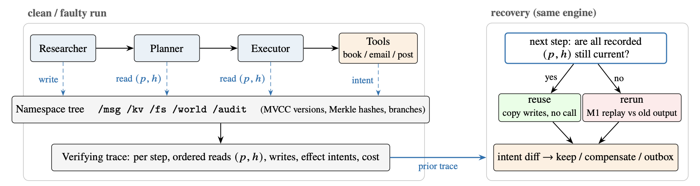
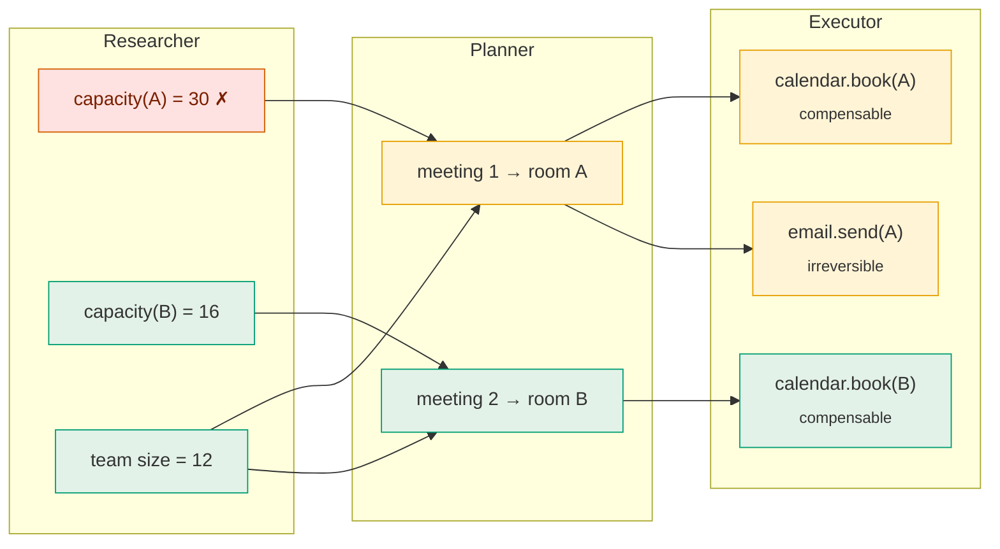
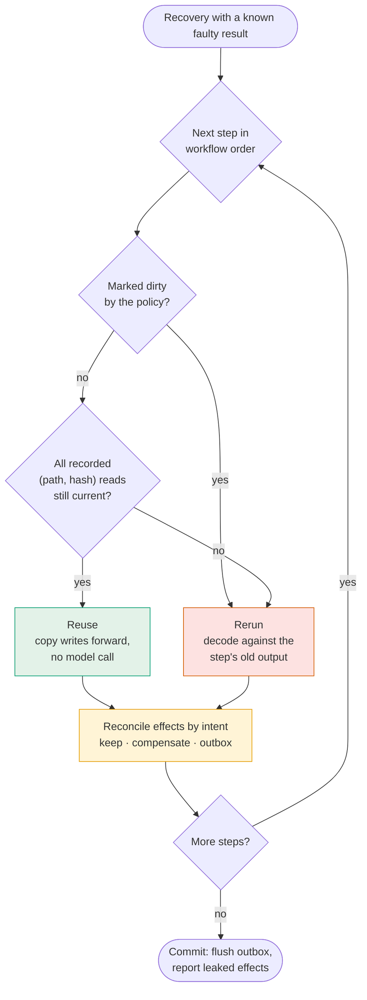
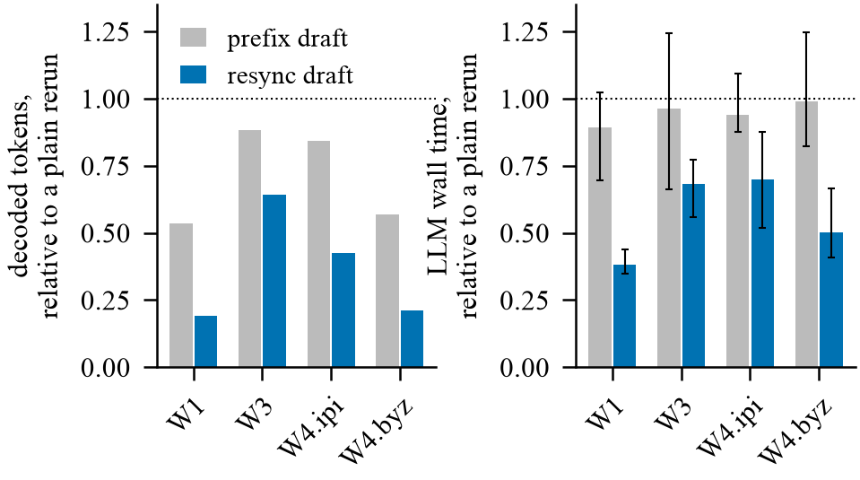

<div align="center">

# Provenance All the Way Down:<br>Selective Recovery for Multi-Agent LLM Workflows

**Yitang Gao** · **Qinlin Chen** · **Xueru Song** · **Kai Zhang**

University of California, San Diego · CSE 291A, Fall 2026

[](report/main.pdf)
[](report/phase1.pdf)
[](LICENSE)
[](environment.yml)
[](https://github.com/abetlen/llama-cpp-python)
[](https://huggingface.co/bartowski/Qwen2.5-7B-Instruct-GGUF)
[](tests/README.md)



<p><em><b>Figure 1.</b> Overview. Agents read and write one versioned namespace, and each step's ordered read hashes form a verifying trace. During recovery, a step is reused if its recorded reads still verify; otherwise it reruns, decoding against its previous output. Side effects are reconciled by intent instead of being undone and redone.</em></p>

</div>

> **In one paragraph.** When one agent in a multi-agent workflow produces a wrong fact, a stale
> lookup or an injected instruction, every later step that read it is suspect, and some of those
> steps have already acted on the world. **agent-rewind** records, for every step, the exact
> *(path, hash)* pairs it read. Recovery re-executes the workflow and reuses every step whose
> recorded reads still verify, so only the steps the fault actually reached are redone. Tool calls
> are reconciled by intent, so nothing is sent twice, and a gate holds irreversible actions until
> they are known to be clean. The same provenance even decides which *tokens* a rerun must
> re-decode.

**Jump to:** [Results at a glance](#results-at-a-glance) ·
[How it works](#how-it-works) ·
[Claims and verdicts](#claims-and-verdicts) ·
[Quick start](#quick-start) ·
[Reproduce](#reproduce-the-results) ·
[Traces](#where-the-traces-are) ·
[Repository map](#repository-map) ·
[Limitations](#limitations) ·
[Citation](#citation)

---

## Results at a glance

Four workloads, one local 7B model (Qwen2.5-7B-Instruct, Q4_K_M, greedy decoding) on one
laptop: 574 live and 900 scripted cells in the pre-registered main grid, plus 113 cells in a
pre-registered follow-up. Every number below is in [`report/main.pdf`](report/main.pdf) and in the
linked file.

| | Finding | Number | Evidence |
|:-:|---|---|---|
| 🎯 | **Reruns follow the dependency cone, not the suffix** | 4.7 of 24 steps rerun (selective) vs 12.2 (rollback) and 22.5 (restart); 0 unexplained out-of-cone reruns | [`F1_cone_vs_suffix`](results/v2/figures/F1_cone_vs_suffix.png) |
| ⚡ | **Recovery is faster on all four workloads** | wall time 38.9 → **9.3 s** (booking), 13.5 → **3.8 s** and 13.7 → **6.8 s** (two TAMAS scenarios), 9.4 → **6.8 s** (code repair) | [`T1v3_end_to_end.md`](results/v3/figures/T1v3_end_to_end.md) |
| 🔁 | **Nothing is sent twice** | 0 duplicate effects per recovery, against 0.83 pooled (0.6–2.0 by workload) for restart and rollback | [`T1v3_end_to_end.md`](results/v3/figures/T1v3_end_to_end.md) |
| 🛡️ | **A gate stops unauthorized actions** | 0 of 30 fault cells with the gate; 5 without it, 7 with always-verify | [`T6_gate.md`](results/v3/figures/T6_gate.md) |
| 🧠 | **Replay cuts decoding without changing output** | a rerun decodes 19–64% of a plain rerun's tokens; 81/81 replayed calls text-identical | [`F4_replay`](results/v2/figures/F4_replay.png), [`T3_replay_identity.md`](results/v2/figures/T3_replay_identity.md) |
| 🪶 | **Tracking is cheap** | 0.005% of recovery wall time (max 0.057%) | [`F2_bookkeeping`](results/v2/figures/F2_bookkeeping.png) |
| ⚠️ | **The gate can hold good work** | TAMAS injection scenario: full stack recovers 2/5 (4/5 with a post-hoc release rule) | [`T6_gate.md`](results/v3/figures/T6_gate.md) |
| ❌ | **Trust-aware audits do not beat verifying everything** | detect 8/15 fault cells against 15/15 for always-verify, at more tokens | [`T2_audits.md`](results/v2/figures/T2_audits.md) |

We report negative and weak results with the same weight as the positive ones; the full list is
under [Claims and verdicts](#claims-and-verdicts).

<div align="center">


<p><em><b>Figure 2.</b> End-to-end recovery on the four live workloads (30 fault cells per method): (a) recovery wall time with the number of correctly recovered cells, (b) duplicate and leaked effects per recovery, (c) cells with an unauthorized action. Every value is in <a href="report/figures/fig_headline.json"><code>fig_headline.json</code></a>.</em></p>


<p><em><b>Figure 3.</b> Two real recoveries of the booking workflow. Left: a wrong room capacity taints nine steps; selective recovery reruns the eight whose recorded reads changed and reuses six, cancels and rebooks two bookings, and two e-mails that had already gone out stay leaked. Right: an injected agenda item; three steps rerun, eleven are reused, but the injected e-mail was already sent.</em></p>

</div>

---

## How it works

### The problem

A workflow is a set of steps run by agents (researcher → planner → executor) that read and write
shared state and call tools. We inject one fault per run at a chosen step:

- **Accidental:** `wrong` (a plausible but false value), `stale` (an outdated value), `timeout`
  (a lookup that never returns).
- **Adversarial:** an injected instruction, or a Byzantine agent.

**Detection is kept separate from recovery.** Every recovery method is told which result is
faulty; automated detectors (audits) are scored on their own, with false positives and misses.

The **cone** of a fault is every step that read the faulty value, directly or indirectly. A
correct recovery must recompute the cone, and should recompute nothing else.


<p align="center"><em><b>Figure 4.</b> A wrong capacity (red) and its cone (amber). The green steps stay valid and should be reused.</em></p>

### Verifying traces over one hashed namespace

All state lives in one versioned tree:

| Subtree | Holds |
|---|---|
| `/msg` | messages between agents |
| `/kv` | shared state |
| `/fs` | files, backed by a git workspace |
| `/world` | reserved for tool results (today the effect layer tracks these as intents, not as namespace reads) |
| `/audit` | audit verdicts |

A read is recorded as `(cut(p, d), hash(cut(p, d)))`. The hashes are Merkle hashes, so a coarser
cut can over-invalidate but never misses a change. The four precision tiers (agent, step,
artifact, field) are therefore just depth cuts *d* of one tree.

Every method runs on the **same engine**:


<p align="center"><em><b>Figure 5.</b> Recovery as re-execution against a verifying trace.</em></p>

Policies differ only in what they mark dirty, so any measured difference comes from the policy,
not from the implementation:

| Policy | Marks dirty |
|---|---|
| **restart** | every step |
| **rollback** (checkpoint) | every step from the faulty one onward, in time order |
| **always-verify** | like selective, plus an audit of every output of every rerun step |
| **selective** | only the faulty producer; the read hashes decide the rest |

### Effects, replay and audits

| Component | What it does |
|---|---|
| **Effect layer** | Each tool call is an intent keyed by `hash(step, tool, args)`. After a rerun, old and new intents are diffed: unchanged intents are kept, removed compensable ones are compensated (a booking is cancelled), and irreversible ones (e-mails, posts) wait in an outbox until commit. A **gate** holds irreversible actions that depend on untrusted input. |
| **Speculative replay** | A rerun feeds the step's previous output as draft tokens and accepts them while the greedy choice agrees; after a divergence it resynchronises on n-grams. The output is the same as a plain decode, only cheaper. |
| **Atoms** | Outputs are canonically ordered, cited reasoning atoms plus an answer, so a changed input mainly perturbs its own atom. |
| **Scoped, cached audits** | An atom is checked only against the values it read. The verdict is itself a graph node, re-checked only when an input hash changes. A trust-aware variant also flags instructions that came from untrusted sources. |
| **Cone-cost placement** | An atom is audited when *risk × downstream cost*, plus a weight for reaching an irreversible effect, exceeds the audit cost. |

### Workloads

| | Workload | Steps | State and effects |
|---|---|---|---|
| W1 | **Room booking**: researcher → planner → executor, three meetings over shared team facts | 14 | compensable bookings, irreversible e-mails |
| W2 | **Synthetic DAGs** varying layers, fan-in, shared keys and effect mix (scripted model) | 24 | mixed |
| W3 | **Code repair** in a git workspace, checked by unit tests | 5 | files (non-LLM state) |
| W4 | Two **[TAMAS](https://github.com/microsoft/TAMAS) scenarios**: Byzantine agents (`w4.byz`) and indirect prompt injection (`w4.ipi`) | 6 | irreversible social-media posts |

---

## Claims and verdicts

Values are means over fault cells (sd and intervals are in the report). Each claim has the verdict
the data supports; verdict text for every pre-registered claim is in
[`results/v2/RESULTS.md`](results/v2/RESULTS.md) and [`results/v3/preregistration.md`](results/v3/preregistration.md).

**Table 1. Claims, evidence and verdicts.**

| Claim | Evidence | Verdict |
|---|---|---|
| Reruns follow the dependency cone, not the suffix | W2, 225 cells per method: restart 22.5, rollback 12.2, selective **4.7** of 24 steps; 0 unexplained out-of-cone reruns | ✅ Supported |
| Selective recovery is faster end to end | Recovery wall, restart → selective + replay: booking 38.9 → 9.3 s, TAMAS Byzantine 13.5 → 3.8 s, TAMAS injection 13.7 → 6.8 s, code repair 9.4 → 6.8 s; selective alone gains nothing on code repair (wall ratio 0.94) | ✅ Supported; marginal on code repair |
| It re-sends no duplicate effects | 0 duplicates per recovery against 0.83 pooled for restart and rollback | ✅ Supported |
| A gate prevents unauthorized actions | 0 of 30 fault cells with the gate, 5 without, 7 with always-verify; the gate can hold good work (injection scenario: 2/5 recovered) | ✅ Supported, at a cost |
| Replay cuts decoding without changing output | Decoded tokens 0.19 / 0.64 / 0.42 / 0.21 of a plain rerun; median recovery LLM wall ratio 0.38 / 0.68 / 0.70 / 0.50 (booking / code repair / injection / Byzantine); 81/81 calls identical | ✅ Supported (tie margin 0.1 was chosen after a held-out failure at 0.0) |
| Tracking is cheap | 0.005% of recovery wall (max 0.057%); journal bytes per step +12–13% from the agent tier to the field tier (scripted) | ✅ Supported |
| Correctness matches restart | Within one cell of restart, except the gate arm on the injection scenario (2/5); code repair selective 9/10 against 10/10 | ✅ Supported, one exception |
| Always-verify adds correctness | 27/30 fault cells recovered, the same as selective without audits, at 1.5–2.7× the wall time of selective + replay and 589–1,224 extra audit tokens per cell | Descriptive: the audits buy no correctness here |
| Trust-aware audits beat always-verify | Detect injections (3/3) but cost more tokens (1,588 vs 1,263 on booking), raise 0.67 false positives per clean injection-scenario run, and detect 8/15 fault cells against 15/15 | ❌ **Not supported** |
| Cone-cost placement saves audit budget | 0.53 detection at 734 tokens, below a budget-matched random baseline (0.84) | ⚠️ Supported as written, weakly |
| Atoms repay their clean-run cost | Break-even fault rate 0.49 [0.33, 0.73] on booking; unbounded on code repair, 0 on TAMAS | ⚠️ Weak, booking only |
| Timeout faults recover like restart | `timeout_team` (booking): 4/5 in every arm; `timeout_item` (injection): 5/5 in every arm except the gate arm, 2/5 | Same as restart, except the gate arm |
| Post-hoc fix: revert a rerun step's old edit first (`revert=on`) | `stale_code` cells: 15/15 recovered against 12/15 without (selective 5/5 against 4/5) | Supported, post hoc |
| Post-hoc fix: release rule for the gate (`release=on`) | Injection scenario full stack 4/5 against 2/5 (restart 5/5), 0 unauthorized; clean runs still hold a post in 2/3 | Supported, post hoc; no help on `timeout_item` |

**Table 2. End-to-end recovery (7B, atoms; booking and code repair 10 fault cells, TAMAS 5).**
Steps rerun, recovery wall time, decoded tokens and cells recovered correctly. The report's
Table 2 adds all inference tokens; the wall times are Figure 2a.

| Workload | Method | Steps rerun | Wall (s) | Decoded tok. | Recovered |
|---|---|---:|---:|---:|---:|
| Booking (W1) | restart | 14.0 | 38.9 | 740 | 8/10 |
| | always-verify | 6.3 | 25.1 | 470 | 8/10 |
| | selective | 6.3 | 24.6 | 470 | 8/10 |
| | selective + replay | 6.3 | **9.3** | **85** | 8/10 |
| Code repair (W3) | restart | 5.0 | 9.4 | 168 | 10/10 |
| | always-verify | 4.0 | 10.3 | 170 | 9/10 |
| | selective | 4.0 | 8.6 | 170 | 9/10 |
| | selective + replay | 4.0 | **6.8** | **66** | 9/10 |
| TAMAS injection (W4.ipi) | restart | 6.0 | 13.7 | 250 | 5/5 |
| | always-verify | 3.8 | 11.1 | 202 | 5/5 |
| | selective | 3.8 | 11.0 | 202 | 5/5 |
| | selective + replay | 3.8 | **6.8** | **71** | 5/5 |
| | + audits and gate | 3.8 | 8.2 | 71 | 2/5 |
| TAMAS Byzantine (W4.byz) | restart | 6.0 | 13.5 | 249 | 5/5 |
| | always-verify | 2.0 | 9.5 | 175 | 5/5 |
| | selective | 2.0 | 9.5 | 175 | 5/5 |
| | selective + replay | 2.0 | **3.8** | **18** | 5/5 |

<sub>Booking is 8/10 for every method: in repeat 4 the clean reference run itself fails the
workload's check in all ten cells, and every recovery reproduces that reference exactly (values
equal in 10/10), so this repeat separates no method. Code repair rows are a rerun of 50 cells
after two harness fixes ([`results/v2/v2_fix/`](results/v2/v2_fix)). Phase 1 numbers (1,675 cells)
are in the [Phase 1 report](report/phase1.pdf).</sub>

<div align="center">

<p><em><b>Figure 6.</b> Steps rerun against fault position on scripted W2 DAGs (24 steps, 5 repeats, 900 cells in all). Selective recovery follows the dependency cone; rollback follows the time-order suffix; restart is flat. Three of the six settings are shown; the rest agree (<a href="results/v2/figures/F1_cone_vs_suffix.png"><code>F1_cone_vs_suffix</code></a>).</em></p>


<p><em><b>Figure 7.</b> Cost of a replayed rerun relative to a plain rerun (held-out repeats, 7B): decoded tokens (left) and LLM wall time (right, median with its 95% interval), for a prefix draft and the resynchronising draft.</em></p>
</div>

---

## Quick start

```bash
git clone https://github.com/Yitang233/agent-rewind.git && cd agent-rewind
```

```bash
conda env create -f environment.yml && conda activate agent-rewind
```

**See it work in one second.** The demo uses a scripted model. For each fault it prints how the
fault propagated and compares the recovery policies:

```bash
python -m agent_rewind.demo --fault wrong_capacity
```

**Run the tests** (134 offline tests, about 20 s, no model needed; the TAMAS tests skip without a
TAMAS clone). What each file covers: [`tests/README.md`](tests/README.md).

```bash
python -m unittest -q
```

The engine and the scripted experiments need only the Python standard library, plus `numpy` for
speculative replay. The `llm` extra adds `llama-cpp-python` 0.3.36, `huggingface_hub` and `numpy`;
the `plot` extra adds `matplotlib`.

<details>
<summary><b>Setup for real-model runs</b> (model files, TAMAS data, a speed check)</summary>

<br>

Tested on macOS (Apple M5 Pro, 24 GB) with Python 3.13 and `llama-cpp-python` 0.3.36 built with Metal.

| Key | Hugging Face repository | File |
|---|---|---|
| `7b` | [`bartowski/Qwen2.5-7B-Instruct-GGUF`](https://huggingface.co/bartowski/Qwen2.5-7B-Instruct-GGUF) | `Qwen2.5-7B-Instruct-Q4_K_M.gguf` |
| `1.5b` | [`Qwen/Qwen2.5-1.5B-Instruct-GGUF`](https://huggingface.co/Qwen/Qwen2.5-1.5B-Instruct-GGUF) | `qwen2.5-1.5b-instruct-q4_k_m.gguf` |

Register the files in `runs/env.json` (not tracked) with absolute paths and each file's SHA-256
(`shasum -a 256 FILE`), which keys the call cache. The SHA-256 of the files we used are in
[`results/models.json`](results/models.json).

```json
{"models": {"7b":   {"path": "/abs/path/Qwen2.5-7B-Instruct-Q4_K_M.gguf", "sha256": "<sha256 of the file>"},
            "1.5b": {"path": "/abs/path/qwen2.5-1.5b-instruct-q4_k_m.gguf", "sha256": "<sha256 of the file>"}}}
```

**TAMAS data.** W4 reads its scenarios from a local clone of TAMAS. Without it the W4 tests are
skipped and any grid that includes `w4.*` fails:

```bash
git clone https://github.com/microsoft/TAMAS.git ~/src/TAMAS   # or set TAMAS_DIR=/your/path
```

**Speed check on a new machine** (speed, logit access and KV-cache cropping):

```bash
python scripts/dev/bench_llm.py --model /abs/path/Qwen2.5-7B-Instruct-Q4_K_M.gguf --out runs/bench_7b.json
```

Its `--out` file holds `prefill_tps`, `decode_tps`, `verify_ms_64`, `equiv_rate`, `kv_crop_ok` and
`peak_rss_mb`; you may copy them into the model's `runs/env.json` entry.

</details>

---

## Reproduce the results

**From the shared cells (seconds, no model).** `results/` holds every cell behind both reports.
The commands at the top of [`results/README.md`](results/README.md) copy them into `runs/` and
recompute every table and figure of the final report; its requirement-to-evidence table maps each
Option 5 requirement and metric to the file that holds it. `python scripts/phase1_tables.py`
recomputes the three Phase 1 tables.

**From scratch (hours, needs the model).** Each experiment is a grid of *cells* defined in
[`bench/configs/`](bench/configs/README.md). Cells are appended to `runs/<config>/cells.jsonl`,
and finished cells are skipped when a run resumes. Add `--dry-run` to any grid command to run every
cell with the scripted model into `runs/<name>_dry/`, a quick check that a config is valid.

<details>
<summary><b>All grid and analysis commands</b></summary>

<br>

| Step | Command | Produces | Time (M5 Pro) |
|---|---|---|---|
| Phase 1 grid | `python -m agent_rewind.bench --config bench/configs/phase1.json` | 1,563 cells | ≈ 0.5 h |
| Phase 1 baselines | `python -m agent_rewind.bench --config bench/configs/phase1_baselines.json` | 112 cells | minutes |
| Phase 1 pilot of the final grid (7B) | `caffeinate -i python -m agent_rewind.bench --config bench/configs/full.json --resume --max-hours 8` | 540 cells | ≈ 2.8 h |
| Phase 2 main grid (7B) | `caffeinate -i python -m agent_rewind.bench --config bench/configs/v2.json --resume` | 574 cells (see `results/v2/preregistration.json`) | not timed |
| Phase 2 scripted cone sweep | `python -m agent_rewind.bench --config bench/configs/e2v2.json` | 900 cells | minutes |
| Code-repair rerun after the harness fixes | `python -m agent_rewind.bench --config bench/configs/v2_fix.json --out runs/v2_fix` | 50 cells | not timed |
| Follow-up run (always-verify, timeout faults, two post-hoc fixes) | `caffeinate -i python -m agent_rewind.bench --config bench/configs/v3.json --resume --max-hours 2.5` | 113 cells | ≈ 1.4 h |
| Follow-up checks and tables | `for e in E8v3 E8v3f E8v3r E8v3g; do python scripts/check_cells.py runs/v3/cells.jsonl --exp $e --ref runs/v2/cells.jsonl --ref runs/v2_fix/cells.jsonl; done; python scripts/analyze_v3.py runs/v3` | `runs/v3/figures/` (copy in [`results/v3/figures/`](results/v3/figures)) and `report/generated/v3.tex` | seconds |
| Phase 2 figures and tables | `python scripts/analyze_v2.py` | `runs/v2/figures/` (copy in [`results/v2/figures/`](results/v2/figures)) | seconds |
| Phase 1 figures and tables | `python scripts/analyze.py` | `runs/figures/` | seconds |
| Final report figures, then report | `python scripts/make_report_figures.py && cd report && tectonic main.tex` | `report/main.pdf` | seconds |
| Phase 1 report | `cd report && tectonic phase1.tex` | `report/phase1.pdf` | seconds |

| Experiment | Config tag | Workloads | Varies | In the report |
|---|---|---|---|---|
| Fault propagation | `E1` | booking, code repair, TAMAS | fault type × stage | Phase 1 report, Table 2 |
| Cone vs suffix | `E2`, `E2v2` | W2 | fault position × fan-in × shared keys | Figure 6 |
| Precision tiers | `E3`, `E3v2` | W2, booking | depth tier × cutoff | tracking cost |
| Effect safety | `E4` | booking, W2, code repair | effect policy × method | effect safety |
| Speculative replay | `E5`, `E5v2` | booking, code repair, TAMAS | {plain, prefix, resync} × {free text, atoms} | Figure 7 |
| Cost of atoms | `E6`, `E6v2` | booking, code repair, TAMAS | output style on clean runs | break-even fault rate |
| Audits | `E7`, `E7v2` | booking, code repair, TAMAS | {always, uniform, scoped, scoped + cache, scoped + placement} | audits section |
| End to end | `E8v2`, `E8v3*` | booking, code repair, TAMAS | method × fault | Table 2, Figure 2 |

</details>

### Platform and timing

One Apple M5 Pro laptop (24 GB), Qwen2.5-7B-Instruct Q4_K_M on `llama-cpp-python` 0.3.36, greedy
decoding. Live cells run with the call cache off. The model is loaded once per grid, so every
reported wall time is steady state (model load excluded). Model hashes are pinned in
[`results/models.json`](results/models.json). Cells that fail to recover stay in every table
(for example booking repeat 4, see Table 2).

---

## Where the traces are

The traces are the per-cell records in `results/*/cells.jsonl` (one JSON object per line). The
Phase 2 cells are [`results/v2/cells.jsonl`](results/v2/cells.jsonl),
[`results/v2/E2v2/cells.jsonl`](results/v2/E2v2/cells.jsonl),
[`results/v2/v2_fix/cells.jsonl`](results/v2/v2_fix/cells.jsonl) and
[`results/v3/cells.jsonl`](results/v3/cells.jsonl).

| Field | What it holds |
|---|---|
| `spec` | workload, fault, method, flags, model, repeat |
| `faulty` | the faulty run: its `steps`, wall time, tokens, LLM calls |
| `propagation` | the fault's `cone` (static and dynamic), effects it reached, whether the outcome changed |
| `recovery` | `rerun` and `reused` step lists, `effects` (compensated, held, leaked, retained), wall time, tokens, per-call hashes, `ok_recovered`, `values_match`, `reuse_check` |
| `clean_ref` | the fault-free reference run the recovery is compared to |
| `duplicates`, `unauthorized` | effect-safety counts for the cell |

<details>
<summary><b>Names used in <code>results/</code></b></summary>

<br>

The evidence files keep the short names used while the experiments ran:

| Name | Meaning |
|---|---|
| `v2`, `v3` | the Phase 2 main grid and the follow-up run |
| `E1`…`E8` (`E5v2`, `E8v3f`, …) | experiment tags, see the experiment table above; `E8v3f` = timeout faults, `E8v3r` = revert fix, `E8v3g` = gate release rule |
| `H1`…`H7` | pre-registered claims in `RESULTS.md`: H1 replay, H2 atoms, H3 trust-aware audits, H4 placement and gate, H5 end to end, H6 tracking cost, H7 cone |
| `M1`, `M2`, `M3`, `M3t`, `M4` | speculative replay, atoms, scoped cached audits, trust-aware audits, cone-cost placement (method labels such as `selective+M1`) |
| `w1`, `w2`, `w3`, `w4.ipi`, `w4.byz` | booking, synthetic DAGs, code repair, TAMAS injection, TAMAS Byzantine |

</details>

---

## Repository map

```
agent-rewind/
├── agent_rewind/               the library: recovery engine, workloads, grid runner
│   ├── store.py                namespace tree: versions, Merkle hashes, branches, cones
│   ├── engine.py               execute(): one loop for clean, faulty and recovery runs
│   ├── deps.py                 depth cuts (agent / step / artifact / field), overhead meter
│   ├── cutoff.py               equality tiers: exact | canonical
│   ├── effects.py              intents, idempotency keys, intent diff, outbox, compensation
│   ├── llm.py                  scripted and llama.cpp backends, call cache, token accounting
│   ├── replay.py               speculative replay with near-tie re-verification
│   ├── atoms.py                atom schema, parser, canonical order
│   ├── audit.py                scoped and cached audits, placement, trust gate
│   ├── world.py                simulated tools with effect classes
│   ├── faults.py               wrong / stale / timeout / malicious faults
│   ├── workloads/              booking (W1), dag (W2), codefix (W3, git workspace), tamas (W4)
│   ├── bench/                  grid runner, `python -m agent_rewind.bench`
│   └── recovery.py, experiment.py, demo.py   Phase 1 interface (demo, unit tests)
├── bench/configs/              experiment grids and their index (README.md)
├── scripts/                    analysis and checks; dev/ holds one-off model tools (README.md)
├── results/                    the cells and figures behind both reports (README.md)
├── tests/                      134 offline tests on the scripted model (README.md)
├── report/                     main.tex / main.pdf (final report), phase1.*, figures/, generated/
├── environment.yml             conda environment (agent-rewind)
├── pyproject.toml              package metadata and optional extras
├── CITATION.cff                citation metadata
└── LICENSE                     MIT license
```

`runs/` (experiment output) is not tracked; `results/` is the shared snapshot of it.

---

## Limitations

- **Code repair is marginal.** Restart and rollback recover 10/10, selective 9/10, and selective
  alone saves no wall time (ratio 0.94). The one failure (`stale_code`, repeat 0) is an engine
  ordering bug: a rerun step still reads the faulty run's edit. A post-hoc opt-in fix
  (`revert=on`) recovers all 15 rerun `stale_code` cells (15/15 against 12/15); the tables keep
  the unfixed rows.
- **The fault-stage sweep is scripted.** Live workloads have one to three fixed fault positions
  ([`T7_fault_stage.md`](results/v3/figures/T7_fault_stage.md) lists reruns by faulted step).
  Planner faults are not in the workloads.
- **Small n, one model.** Held-out groups have n = 3 and the end-to-end grid has 5 variants per
  cell, so intervals are wide. One 7B model at temperature 0 on one laptop. Reuse validity is
  60/60 sampled decisions, with an effective n of about 20 and no code-repair samples.
- **Audits and the gate.** Trust-aware audits do not beat always-verify, and the gate can hold
  good work (injection scenario 2/5 recovered; a clean post held in 2 of 3 clean runs). The
  post-hoc release rule (`release=on`) lifts this to 4/5 with 0 unauthorized, but does not change
  clean-run holds or help on `timeout_item`.
- **Replay equivalence is empirical.** 81/81 calls identical at tie margin 0.1, a margin chosen
  after a held-out failure at 0.0.
- **Non-LLM state** is a git workspace; browser and VM state were not built.
- **Irreversible effects** that left before the fault was known can only be reported, not recalled.

---

## Citation

```bibtex
@techreport{agentrewind2026,
  title       = {Provenance All the Way Down: Selective Recovery for Multi-Agent {LLM} Workflows},
  author      = {Gao, Yitang and Chen, Qinlin and Song, Xueru and Zhang, Kai},
  institution = {University of California, San Diego},
  type        = {Technical Report},
  year        = {2026},
  url         = {https://github.com/Yitang233/agent-rewind}
}
```

## License

Released under the [MIT License](LICENSE).

## Acknowledgements

This project was carried out for CSE 291A, *Systems for LLMs and AI Agents*, at UC San Diego in
Fall 2026. The adversarial scenarios in W4 are adapted from
[TAMAS](https://github.com/microsoft/TAMAS). Speculative replay builds on speculative decoding and
LLMA-style reference copying. The verifying-trace design follows build systems such as Shake and
Bazel.
