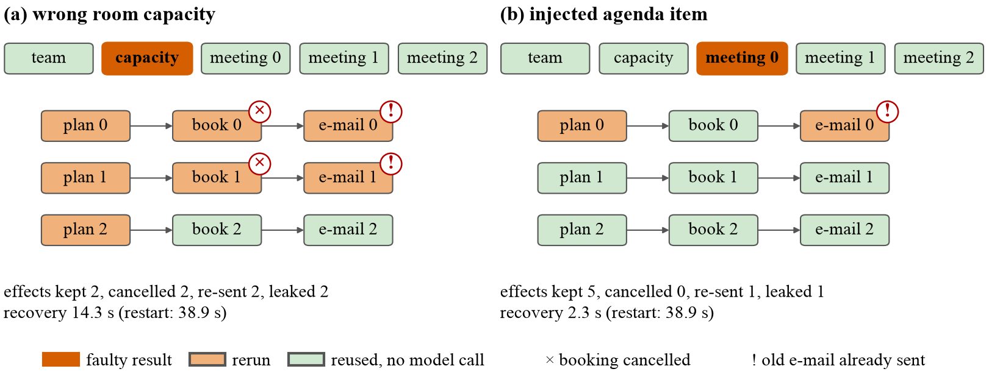
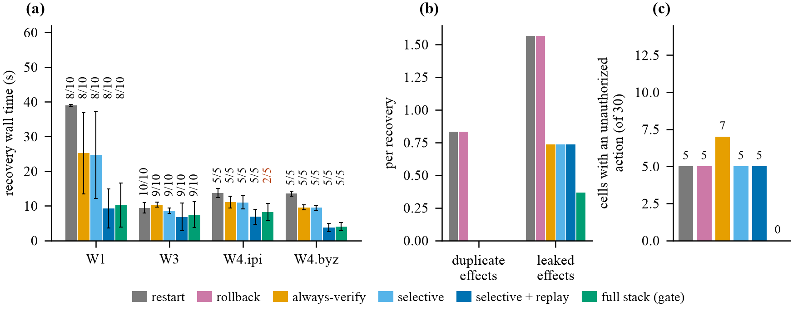
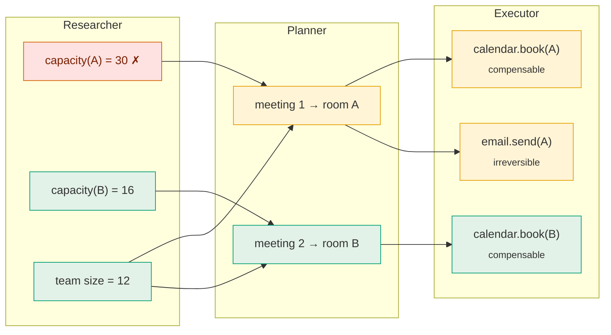
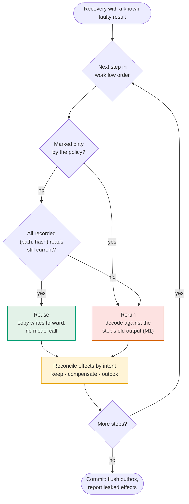
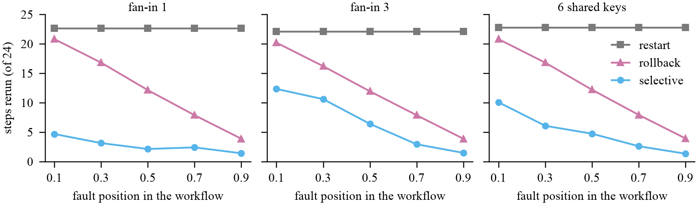

<div align="center">

# Provenance All the Way Down:<br>Selective Recovery for Multi-Agent LLM Workflows

**Yitang Gao** · **Qinlin Chen** · **Xueru Song** · **Kai Zhang**

University of California, San Diego

[](report/main.pdf)
[](report/phase1.pdf)
[](LICENSE)
[](environment.yml)
[](https://github.com/abetlen/llama-cpp-python)
[](https://huggingface.co/bartowski/Qwen2.5-7B-Instruct-GGUF)


<p><em><b>Figure 1.</b> Overview. Agents read and write one versioned namespace, and each step's ordered read hashes form a verifying trace. During recovery, a step is reused if its recorded reads still verify; otherwise it reruns, decoding against its previous output. Side effects are reconciled by intent instead of being undone and redone.</em></p>



<p><em><b>Figure 2.</b> Two real recoveries of the booking workflow (W1). Left: a wrong room capacity; selective recovery reruns 8 steps, reuses 6, cancels two bookings, and two already-sent e-mails stay leaked. Right: an injected agenda item; 3 steps rerun, 11 reused, the injected e-mail was already sent.</em></p>



<p><em><b>Figure 3.</b> End-to-end recovery on the four live workloads: (a) recovery wall time with the number of correctly recovered cells, (b) duplicate and leaked effects per recovery, (c) cells with an unauthorized action. Every number is in <a href="results/README.md">results/README.md</a>'s evidence table.</em></p>

</div>

---

## Abstract

When an agent in a multi-agent workflow produces a wrong fact, a stale lookup or
an injected instruction, every later step that read it is suspect, and some of
those steps have already acted on the world. We ask whether tracking the exact
dependencies between agent results makes recovery both cheap and safe.
**agent-rewind** records, for every step, the ordered *(path, Merkle hash)*
pairs it read from one hierarchical namespace of messages, shared state, files
and tool results. Recovery re-executes the workflow and reuses every step whose
recorded reads still verify. Early cutoff, precision tiers and dynamic branching
all follow from that single rule. The same provenance also decides which
*tokens* a rerun must re-decode (speculative replay against the step's old
output) and which *audits* must be redone.

We evaluate on four workloads with a local 7B model (574 live cells plus 900
scripted cells, pre-registered):
- Selective recovery reruns 4.7 of 24 steps on synthetic DAGs, where restart
  reruns 22.5 (0 unexplained out-of-cone reruns in 225 cells).
- On the live workloads, selective recovery with replay cuts recovery wall time
  from 38.9 s to 9.3 s (W1), 13.5 s to 3.8 s (W4.byz), 13.7 s to 6.8 s (W4.ipi)
  and 9.4 s to 6.8 s (W3). On W3 selective alone saves nothing (ratio 0.94).
- Speculative replay decodes 19–64% of a plain rerun's tokens, with a median
  recovery LLM wall ratio of 0.38–0.70 and 81/81 text-identical calls.
- Selective recovery re-sends no duplicate effects (restart: 0.6–2.0 per
  recovery). A gate on irreversible actions leaves 0 unauthorized actions in the
  30 fault cells (5 for restart and selective, 7 for always-verify), but it can
  hold good work: the W4.ipi full stack recovers 2/5.
- Trust-aware audits do not beat always-verify (more tokens, false positives
  on W4.ipi); we report this as a negative result.

---

## Contents

1. [Method](#1-method)
2. [Installation](#2-installation)
3. [Quick Start](#3-quick-start)
4. [Reproducing the Results](#4-reproducing-the-results)
5. [Main Results](#5-main-results)
6. [Repository Structure](#6-repository-structure)
7. [Limitations](#7-limitations)
8. [Citation](#8-citation)
9. [License](#9-license)
10. [Acknowledgements](#10-acknowledgements)

---

## 1. Method

### 1.1 Problem setting

A workflow is a set of steps run by agents (researcher → planner → executor)
that read and write shared state and call tools. A single fault is injected at
a chosen step:

- **Accidental faults:** `wrong`, `stale`, `timeout`.
- **Adversarial faults:** an injected instruction or a Byzantine agent.

The two classes are reported separately. Detection
is kept separate from recovery: every recovery method is told which result is
faulty, and automated detectors (audits) are scored on their own.

The *cone* of a fault is every step that read the faulty value, directly or
indirectly. A correct recovery must recompute the cone, and should recompute
nothing else.


<p align="center"><em><b>Figure 2.</b> A wrong capacity (red) and its cone (amber). The green steps stay valid and should be reused.</em></p>

### 1.2 Verifying traces over a Merkle namespace

All state lives in one versioned tree:

| Subtree | Holds |
|---|---|
| `/msg` | messages between agents |
| `/kv` | shared state |
| `/fs` | files, backed by a git workspace |
| `/world` | reserved for tool results (today these are tracked as intents by the effect layer, not as namespace reads) |
| `/audit` | audit verdicts |

A read is recorded as `(cut(p, d), hash(cut(p, d)))`. Because the hashes are
Merkle hashes, a coarser cut can over-invalidate but never misses a change. The
four precision tiers (agent, step, artifact, field) are therefore depth cuts
*d* of one tree.

All methods share a single engine:


<p align="center"><em><b>Figure 3.</b> Recovery as re-execution against a verifying trace.</em></p>

Policies differ only in what they mark dirty. Any measured difference therefore
comes from the policy, not from the implementation:

| Policy | Marks dirty |
|---|---|
| `restart` | every step |
| `rollback` | every step from the faulty one onward, in time order |
| `selective` | only the faulty producer; hashes decide the rest |

### 1.3 Effects, replay and audits

| Component | Mechanism |
|---|---|
| **Effect layer** | Each tool call is an intent keyed by `hash(step, tool, args)`. After a rerun, old and new intents are diffed: unchanged intents are kept, removed compensable ones are compensated, and irreversible ones wait in an outbox until commit. |
| **M1: speculative replay** | The rerun feeds the step's previous output as draft tokens and accepts them while the greedy argmax agrees. After a divergence, it resynchronises on n-grams. |
| **M2: atoms** | Outputs are canonically ordered, cited reasoning atoms plus an answer, so a changed input mainly perturbs its own atom. |
| **M3: scoped, cached audits** | An atom is checked only against the values it read. The verdict is a graph node that is re-checked only when an input hash changes. |
| **M4: cone-cost placement** | An atom is audited when *risk × downstream cost*, plus a weight for reaching an irreversible effect, exceeds the audit cost. |

---

## 2. Installation

Tested on macOS (Apple M5 Pro, 24 GB) with Python 3.13 and
`llama-cpp-python` 0.3.36, built with Metal.

```bash
git clone https://github.com/Yitang233/agent-rewind.git && cd agent-rewind
```

```bash
conda env create -f environment.yml
```

```bash
conda activate agent-rewind
```

The core engine and the scripted experiments use only the Python standard
library, except that speculative replay (`replay.py`) and its tests need
`numpy`. The `llm` extra adds `llama-cpp-python`, `huggingface_hub` and `numpy`;
the `plot` extra adds `matplotlib`.

**Models.** These are needed only for real-model experiments.

| Key | Hugging Face repository | File |
|---|---|---|
| `7b` | [`bartowski/Qwen2.5-7B-Instruct-GGUF`](https://huggingface.co/bartowski/Qwen2.5-7B-Instruct-GGUF) | `Qwen2.5-7B-Instruct-Q4_K_M.gguf` |
| `1.5b` | [`Qwen/Qwen2.5-1.5B-Instruct-GGUF`](https://huggingface.co/Qwen/Qwen2.5-1.5B-Instruct-GGUF) | `qwen2.5-1.5b-instruct-q4_k_m.gguf` |

Register the downloaded files in `runs/env.json` (not tracked), using absolute
paths and each file's SHA-256 (`shasum -a 256 FILE`), which keys the call cache.
The real-model grids and `scripts/` read both fields:

```json
{"models": {"7b":   {"path": "/abs/path/Qwen2.5-7B-Instruct-Q4_K_M.gguf", "sha256": "<sha256 of the file>"},
            "1.5b": {"path": "/abs/path/qwen2.5-1.5b-instruct-q4_k_m.gguf", "sha256": "<sha256 of the file>"}}}
```

**TAMAS data.** W4 reads its scenarios from a local clone of TAMAS. Without it,
the W4 tests are skipped and any grid that includes `w4.*` fails:

```bash
git clone https://github.com/microsoft/TAMAS.git ~/src/TAMAS   # or set TAMAS_DIR=/your/path
```

To check speed, logit access and KV-cache cropping on a new machine, run:

```bash
python scripts/dev/bench_llm.py --model /abs/path/Qwen2.5-7B-Instruct-Q4_K_M.gguf --out runs/bench_7b.json
```

Its `--out` file holds `prefill_tps`, `decode_tps`, `verify_ms_64`, `equiv_rate`,
`kv_crop_ok` and `peak_rss_mb`; you may copy them into the model's `runs/env.json`
entry next to `path` and `sha256`.

---

## 3. Quick Start

The demo uses a scripted model and runs in about one second. For each fault it
prints how the fault propagated and compares the recovery policies:

```bash
python -m agent_rewind.demo --fault wrong_capacity
```

Run the offline test suite (about 20 s; no model needed; the W4 tests need the
TAMAS clone). What each file covers: [`tests/README.md`](tests/README.md).

```bash
python -m unittest -q
```

---

## 4. Reproducing the Results

Each experiment is a grid of *cells* defined in `bench/configs/`. Cells are
appended to `runs/<config name>/cells.jsonl` (for example
`runs/phase1_baselines/cells.jsonl`), and finished cells are skipped when a run
resumes. `scripts/analyze.py` reads these three files and warns about any that
are missing.

| Step | Command | Produces | Time (M5 Pro) |
|---|---|---|---|
| Phase 1 grid (E1–E4) | `python -m agent_rewind.bench --config bench/configs/phase1.json` | 1,563 cells | ≈ 0.5 h |
| Phase 1 baselines | `python -m agent_rewind.bench --config bench/configs/phase1_baselines.json` | 112 cells | minutes |
| Full grid (E5–E8, 7B) | `caffeinate -i python -m agent_rewind.bench --config bench/configs/full.json --resume --max-hours 8` | 540 cells | ≈ 2.8 h |
| Phase 2 grid (E5v2–E8v2, 7B) | `caffeinate -i python -m agent_rewind.bench --config bench/configs/v2.json --resume` | 574 cells (see `results/v2/preregistration.json`) | not timed |
| Phase 2 scripted E2v2 | `python -m agent_rewind.bench --config bench/configs/e2v2.json` | 900 cells | minutes |
| Phase 2 W3 rerun after the harness fixes | `python -m agent_rewind.bench --config bench/configs/v2_fix.json --out runs/v2_fix` | 50 cells | not timed |
| Phase 2 v3 run (always-verify, timeout faults, two post-hoc fixes) | `caffeinate -i python -m agent_rewind.bench --config bench/configs/v3.json --resume --max-hours 2.5` | 113 cells | about 1.4 h |
| Phase 2 v3 check and figures | `for e in E8v3 E8v3f E8v3r E8v3g; do python scripts/check_cells.py runs/v3/cells.jsonl --exp $e --ref runs/v2/cells.jsonl --ref runs/v2_fix/cells.jsonl; done; python scripts/analyze_v3.py runs/v3` | `runs/v3/figures/` (T1v3, T4–T7, F9, `analysis_v3.json`; copy in [`results/v3/`](results/v3)) | seconds |
| Phase 2 figures and tables | `python scripts/analyze_v2.py` | `runs/v2/figures/` (F1–F8, T1–T3, `analysis_v2.json`; a copy is in [`results/v2/figures/`](results/v2/figures)) | seconds |
| Phase 1 figures and tables | `python scripts/analyze.py` | `runs/figures/` | seconds |
| Final report figures, then report | `python scripts/make_report_figures.py && cd report && tectonic main.tex` | `report/main.pdf` | seconds |
| Phase 1 report | `cd report && tectonic phase1.tex` | `report/phase1.pdf` | seconds |

Add `--dry-run` to any grid command to run every cell with the scripted model
into `runs/<name>_dry/`. It needs no model and is a quick check that a config is valid.

| Experiment | Workloads | Varies | Reported as |
|---|---|---|---|
| E1 propagation | W1, W3, W4 | fault type × stage | Phase 1 report, Table 2 |
| E2 cone vs suffix | W2 | fault position × fan-in × shared keys | Figure 4 (P1) |
| E3 precision | W2, W1 | depth tier × cutoff | P2 |
| E4 effects | W1, W2, W3 | effect policy × method | P3 |
| E5 replay | W1, W3, W4 | {plain, prefix, resync} × {free CoT, atoms} | C-A |
| E6 structure cost | W1, W3, W4 | output style on clean runs | C-B |
| E7 audits | W1, W3, W4 | {always, uniform, M3, M3+cache, M3+M4} | C-C, C-D |
| E8 end-to-end | W1, W3, W4 | policy × fault | Table 2 |

**Workloads.**

| | Workload | Steps | State and effects |
|---|---|---|---|
| W1 | Room booking: researcher → planner → executor, three meetings over shared team facts | 14 | compensable bookings, irreversible e-mails |
| W2 | Synthetic DAGs varying layers, fan-in, shared keys and effect mix (scripted) | 24 | mixed |
| W3 | Code fix in a git workspace, checked by unit tests | 5 | files |
| W4 | Two [TAMAS](https://github.com/microsoft/TAMAS) scenarios: Byzantine agents (`w4.byz`) and indirect prompt injection (`w4.ipi`) | 6 | irreversible posts |

---

## 5. Main Results

All real-model numbers use Qwen2.5-7B-Instruct (Q4_K_M) with greedy decoding.
Values are mean ± sd. Full tables and every caveat are in the
[report](report/main.pdf).

**Table 1. Claims and verdicts (Phase 2, [`results/v2/RESULTS.md`](results/v2/RESULTS.md)).**

| Claim | Evidence | Verdict |
|---|---|---|
| **H7 / P1** Reruns follow the dependency cone | Steps rerun of 24 (W2, 225 cells per method): restart 22.5, rollback 12.2, selective **4.7**; 0 unexplained out-of-cone reruns | Supported |
| **H6 / P2** Bookkeeping is cheap | Bookkeeping 0.005% of recovery wall (max 0.057%); journal bytes per step +12–13% from agent to field | Supported |
| **H1 / C-A** Speculative replay (M1) | Decoded tokens 0.19 / 0.64 / 0.42 / 0.21 of a plain rerun; median recovery LLM wall ratio 0.38 / 0.68 / 0.70 / 0.50 (W1 / W3 / W4.ipi / W4.byz); 81/81 calls identical | Supported (margin 0.1 was chosen after a held-out failure at 0.0) |
| **H2 / C-B** Atoms break even | p\* by wall time: W1 0.49 [0.33, 0.73], W3 unbounded, W4 0 | Supported as written, weakly (only W1 is non-trivial) |
| **H3 / C-C** Trust-aware audits (m3t) | Detect injections (3/3) but cost more tokens than always-verify (1588 vs 1263 on W1) and have 0.67 false positives per clean W4.ipi run | **Not supported** |
| **H4 / C-D** Placement and gate (M4) | m3t+m4 pooled detection 0.53 at 734 tokens, below a budget-matched random baseline (0.84); gate: 0 unauthorized in 6/6 injection cells, 3/3 and 1/3 without | Supported as written, weakly; the gate costs W4.ipi 2/5 recovered |
| **Always-verify end to end** (E8v3) | 27/30 fault cells recovered, the same as selective without audits; recovery wall 2.7 / 1.5 / 1.6 / 2.5x of selective + M1 (W1 / W3 / W4.ipi / W4.byz); 589–1224 extra audit tokens per cell | Descriptive: the audits buy no correctness here |
| **Timeout faults** (E8v3f) | `timeout_team` (W1): 4/5 in every arm; `timeout_item` (W4.ipi): 5/5 in every arm except the full-stack gate arm, 2/5 (3 posts held) | Same as restart, except the gate arm on `timeout_item` |
| **`stale_code` engine fix, post hoc** (E8v3r) | 15/15 with `revert=on` against 12/15 without (selective 5/5 against 4/5; restart 5/5) | Supported |
| **Gate release rule, post hoc** (E8v3g) | W4.ipi full stack 4/5 against 2/5 without the rule (restart 5/5), 0 unauthorized; clean runs still hold a post in 2/3 | Supported (within one cell of restart); does not help on `timeout_item` |
| **H5** Selective recovery end to end | Table 2 below: fewer reruns and less wall time on 4 of 4 workloads; 0 duplicate effects against 0.6–2.0 for restart | Supported (W3 marginal) |

**Table 2. End-to-end recovery (E8v2 and E8v3, atoms, 7B).** Steps rerun, recovery wall
time, decoded tokens and the number of cells recovered correctly. W3 rows are a
rerun after two harness fixes (`results/v2/v2_fix`).

| Workload | Method | Steps rerun | Wall (s) | Decoded tok. | Recovered |
|---|---|---:|---:|---:|---:|
| W1 | restart | 14.0 | 38.9 | 740 | 8/10 |
| W1 | always-verify | 6.3 | 25.1 | 470 | 8/10 |
| W1 | selective | 6.3 | 24.6 | 470 | 8/10 |
| W1 | selective + M1 | 6.3 | **9.3** | **85** | 8/10 |
| W3 | restart | 5.0 | 9.4 | 168 | 10/10 |
| W3 | always-verify | 4.0 | 10.3 | 170 | 9/10 |
| W3 | selective | 4.0 | 8.6 | 170 | 9/10 |
| W3 | selective + M1 | 4.0 | **6.8** | **66** | 9/10 |
| W4.ipi | restart | 6.0 | 13.7 | 250 | 5/5 |
| W4.ipi | always-verify | 3.8 | 11.1 | 202 | 5/5 |
| W4.ipi | selective | 3.8 | 11.0 | 202 | 5/5 |
| W4.ipi | selective + M1 | 3.8 | **6.8** | **71** | 5/5 |
| W4.ipi | + audits and gate | 3.8 | 8.2 | 71 | 2/5 |
| W4.byz | restart | 6.0 | 13.5 | 249 | 5/5 |
| W4.byz | always-verify | 2.0 | 9.5 | 175 | 5/5 |
| W4.byz | selective | 2.0 | 9.5 | 175 | 5/5 |
| W4.byz | selective + M1 | 2.0 | **3.8** | **18** | 5/5 |

<sub>W1 `ok_recovered` is 8/10 for every method: in repeat 4 the clean reference run
itself fails the workload's check in all ten cells, and every recovery reproduces that
reference (values equal 10/10), so it separates no method. The v1 numbers (2,215 cells) are in the Phase 1 report.</sub>

<div align="center">

<p><em><b>Figure 4.</b> Steps rerun against fault position on scripted W2 DAGs (24 steps, 5 repeats, 900 cells in all). Selective recovery follows the dependency cone; rollback follows the time-order suffix; restart is flat. Three of the six settings are shown; the rest agree (`results/v2/figures/F1`).</em></p>


<p><em><b>Figure 5.</b> Cost of a replayed rerun relative to a plain rerun (held-out repeats, 7B): decoded tokens (left) and LLM wall time (right, median with its 95% interval), for a prefix draft and the resynchronising draft.</em></p>
</div>

---

## 6. Repository Structure

```
agent-rewind/
├── agent_rewind/               the library: recovery engine, workloads, grid runner
│   ├── store.py                namespace tree: MVCC versions, Merkle hashes, branches, cones
│   ├── engine.py               execute(): one loop for clean, faulty and recovery runs
│   ├── deps.py                 depth cuts (agent / step / artifact / field), overhead meter
│   ├── cutoff.py               equality tiers: exact | canonical
│   ├── effects.py              intents, idempotency keys, intent diff, outbox, compensation
│   ├── llm.py                  scripted and llama.cpp backends, call cache, token accounting
│   ├── replay.py               M1 speculative replay with near-tie re-verification
│   ├── atoms.py                M2 atom schema, parser, canonical order
│   ├── audit.py                M3 scoped and cached audits, M4 placement, trust gate
│   ├── world.py                simulated tools with effect classes
│   ├── faults.py               wrong / stale / timeout / malicious faults
│   ├── workloads/              booking (W1), dag (W2), codefix (W3, git workspace), tamas (W4)
│   ├── bench/                  grid runner, `python -m agent_rewind.bench`
│   │   ├── config.py           flag defaults and choices
│   │   ├── grid.py             config -> cell specs and cell keys
│   │   ├── cases.py            workload cases and outcome checks
│   │   ├── models.py           model loading, audit checkers and calibration
│   │   ├── metrics.py          call recording, hash timing, bookkeeping
│   │   ├── cell.py             one cell: faulty run, recovery, clean reference
│   │   ├── progress.py         result rows, progress file, hours estimate
│   │   └── cli.py              command line (`__main__.py` calls it)
│   └── recovery.py, experiment.py, demo.py   Phase 1 interface (demo, unit tests)
├── bench/configs/              experiment grids and their index (README.md)
├── scripts/                    analysis and checks; dev/ holds one-off model tools (README.md)
├── results/                    shared copy of the cells and figures behind the reports
│   ├── README.md               requirement-to-evidence table and the commands that recompute it
│   ├── phase1/, phase1_baselines/, logs/   Phase 1 cells and logs
│   ├── v2/                     v2 cells, E2v2, v2_fix, pre-registration, verdicts (RESULTS.md), figures
│   └── v3/                     v3 cells, pre-registration, tables and figures
├── tests/                      offline suite (scripted model): engine, effects, audits, replay, workloads, grid runner
├── report/                     main.tex (final report), phase1.tex, refs.bib, figures/, generated/ (v3.tex macros)
├── environment.yml             conda environment (agent-rewind)
├── pyproject.toml              package metadata and optional extras
├── CITATION.cff                citation metadata
└── LICENSE                     MIT license
```

Experiment output (`runs/`) is not tracked. `results/` holds a snapshot of the cells behind both
reports; `python scripts/phase1_tables.py` recomputes the three Phase 1 tables, and the commands at the
top of [`results/README.md`](results/README.md) recompute the Phase 2 tables and figures.

---

## 7. Limitations

- **W3 is marginal.** After the harness fixes, restart and rollback recover 10/10
  and selective 9/10; selective alone saves no wall time (ratio 0.94). The one
  failure (`stale_code`, repeat 0) is an engine ordering bug: a rerun step
  still reads the faulty run's edit. A post-hoc opt-in fix (`revert_early`, bench flag
  `revert=on`) recovers all 15 rerun `stale_code` cells (15/15 against 12/15); the
  table keeps the unfixed rows.
- **Grid gaps.** The fault-stage sweep exists only on scripted W2 (live
  workloads have 1–2 fixed fault positions; `results/v3/figures/T7_fault_stage.md`
  lists reruns by faulted step). Planner faults of the teammates' pull request are
  not in this repository, so they are not in the grid. Both fixes (`revert=on`,
  `release=on`) are post hoc.
- **Small n and one model.** Held-out groups have n = 3; E8v2 has 5 variants;
  one 7B model at temperature 0 on one laptop. Reuse validity is 60/60 with an
  effective n of about 20 and no W3 samples.
- **Audits and gate.** H3 is not supported, and the gate can hold good work
  (W4.ipi full stack 2/5 recovered; a clean post held in 2 of 3 clean runs). The
  post-hoc release rule (`release=on`) lifts W4.ipi to 4/5 with 0 unauthorized, but
  does not change clean-run holds or help on `timeout_item` (2/5).
- **Replay equivalence is empirical.** 81/81 calls identical at margin 0.1,
  which was chosen after a held-out failure at margin 0.0.
- **Non-LLM state** is a git workspace; there is no browser or VM snapshot.
- **Irreversible effects** that left before the fault was known can only be
  reported, not recovered.

---

## 8. Citation

```bibtex
@techreport{agentrewind2026,
  title       = {Provenance All the Way Down: Selective Recovery for Multi-Agent {LLM} Workflows},
  author      = {Gao, Yitang and Chen, Qinlin and Song, Xueru and Zhang, Kai},
  institution = {University of California, San Diego},
  type        = {Technical Report},
  year        = {2026},
  url         = {https://github.com/Yitang233/agent-rewind}
}
```

---

## 9. License

Released under the [MIT License](LICENSE).

---

## 10. Acknowledgements

This project was carried out for CSE 291A, *Systems for LLMs and AI Agents*, at
UC San Diego in Fall 2026. The adversarial scenarios in W4 are adapted from
[TAMAS](https://github.com/microsoft/TAMAS). Speculative replay builds on
speculative decoding and LLMA-style reference copying. The verifying-trace
design follows build systems such as Shake and Bazel.
